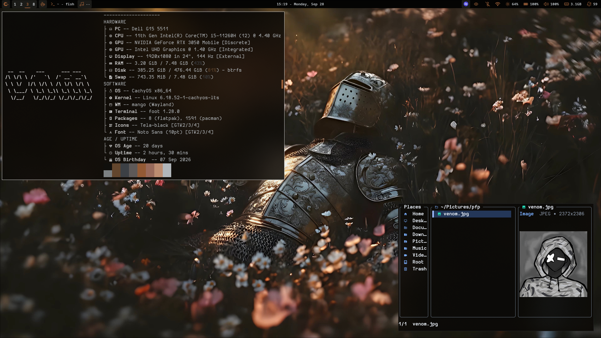
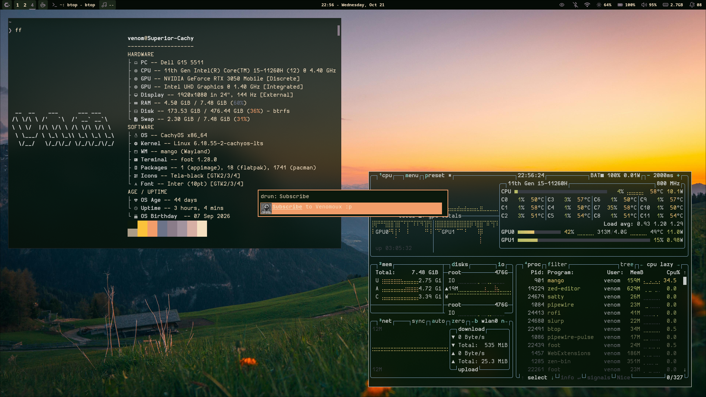
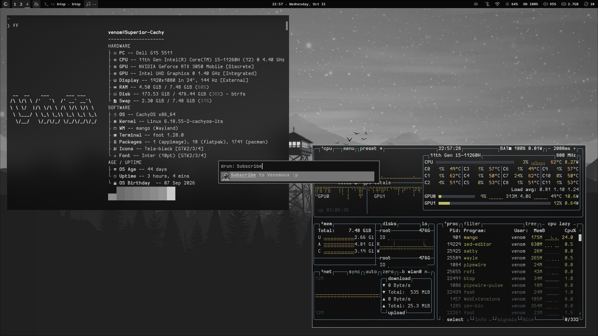
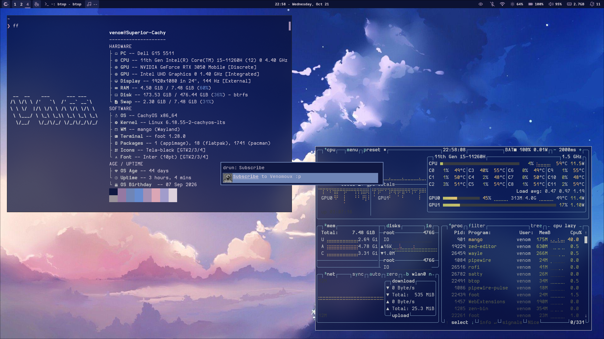
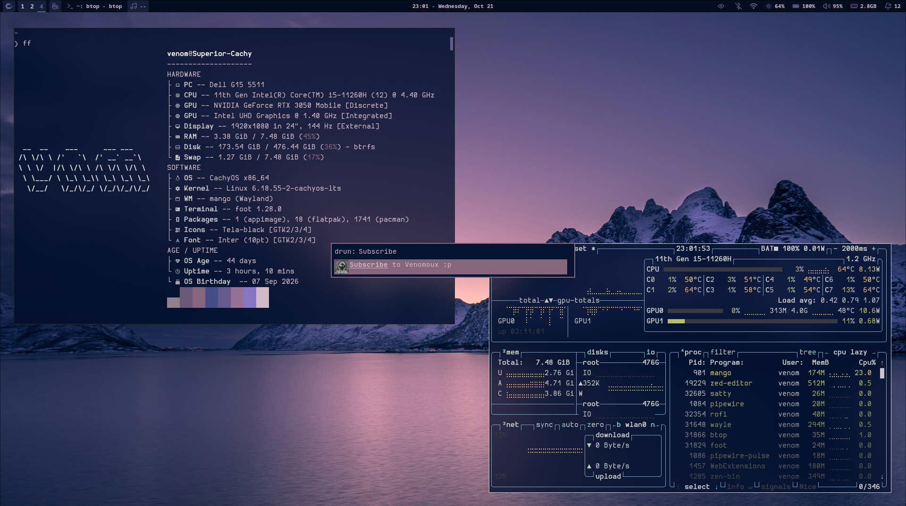

<h1 align="center">【 venomous's dotfiles 】</h1>

## [Join Fluxer Server](https://fluxer.gg/NkvInTZn)

# A Simple Personal setup of MangoWM 

---

## Stuff I like about this setup
* **Wayle Shell:** Comes with a GUI to setup and the status-bar got clickable buttons.
* **Bash Scripts:** I made a couple of bash scripts for stuff like changing wallpaper, managing monitors, powermenu.
* **Pywal:** Terminal, Wayle shell, and Rofi changes it's color based on wallpaper.
* **Stow Managed:** Damn it's easy to manage dotfiles using Stow. Stow is used to symlink dotfiles from your folder (where you store your dotfiles) into the respective application's configuration directories.
---

## Preview


### 🎨 Pywal for Status bar, Terminal, and Rofi
<div style="display: flex; gap: 10px;">
  
  
  
  
</div>

---

## Softwares
Since this is my personal setup, I'm going to list every software/dependency I use. Download only what you need :3<br>Don't forget to replace keybinds for *other* software with the ones you use.

| Category | Name | Description |
|---|---|---|
| **Compositor** | [MangoWM](https://mangowm.github.io/) | A lightweight and feature-rich Wayland compositor based on dwl. |
| **Symlink** | [GNU Stow](https://www.gnu.org/software/stow/) | Symlink manager that makes it easy to organize and install dotfiles. |
| **Status Bar** | [Wayle](https://wayle.app/guide/getting-started) | Wayland desktop shell written in Rust with GTK4 and Relm4. |
| **Wallpaper Engine** | [awww](https://github.com/LGFae/awww) | Animated wallpaper daemon for Wayland that manages and transitions wallpapers. |
| **App Launcher** | [Rofi](https://github.com/davatorium/rofi) | A window switcher, application launcher and dmenu replacement. |
| **Color Generation** | [Pywal](https://github.com/dylanaraps/pywal) | Generates a color palette from the dominant colors in an image. |
| **Brightness Control** | [brightnessctl](https://github.com/Hummer12007/brightnessctl) | Command-line utility for controlling screen and keyboard brightness. |
| **Screenshot** | [grim](https://gitlab.freedesktop.org/emersion/grim) | Screenshot utility for capturing Wayland desktops and windows. |
| **Screenshot Editor** | [satty](https://github.com/gabm/satty) | Screenshot annotation tool for drawing, highlighting and editing screenshots. |
| **Screenshot Selection** | [slurp](https://gitlab.freedesktop.org/emersion/slurp) | Selects a region of the screen for screenshot and screen-recording utilities. |
| **Idle Manager** | [swayidle](https://github.com/swaywm/swayidle) | Idle management daemon that executes commands after a specified period of inactivity. |
| **Lock Screen** | [swaylock](https://github.com/swaywm/swaylock) | Screen locker for Wayland compositors. |
| **Shell** | [Fish](https://fishshell.com/) | Smart and user-friendly command-line shell with autosuggestions and syntax highlighting. |
| **XDG Utilities** | [xdg-utils](https://gitlab.freedesktop.org/xdg/xdg-utils) | Set of command-line tools for managing default applications and opening files or URLs. |
| **XDG Portal** | [xdg-desktop-portal-wlr](https://github.com/emersion/xdg-desktop-portal-wlr) | XDG Desktop Portal backend for wlroots-based Wayland compositors, providing screen sharing and screenshot interfaces. |
| **Audio** | [PipeWire](https://pipewire.org/) | Low-latency multimedia framework for handling audio and video streams on Linux. |
| **Night Light** | [wlsunset](https://github.com/kennylevinsen/wlsunset) | Adjusts display color temperature according to the time of day to reduce blue light at night. |
| **Emoji Picker** | [Rofi-emoji](https://github.com/Mange/rofi-emoji) | Rofi extension for searching and selecting emojis. |
| **Terminal** | [Foot](https://github.com/dnkl/foot) | Lightweight and fast terminal emulator designed specifically for Wayland. |
| **Image Viewer** | [Gwenview](https://github.com/KDE/gwenview) | Fast and feature-rich image viewer with basic image editing capabilities. |
| **File Manager** | [Thunar](https://docs.xfce.org/xfce/thunar/start) | Lightweight graphical file manager from the XFCE desktop environment. |
| **File Manager** | [Elio](https://elio-fm.github.io/) | Lightweight terminal-based file manager with a keyboard-driven workflow. |
| **Code Editor** | [Helix](https://helix-editor.com/) | Modern terminal-based text editor with built-in language server support, syntax highlighting and modal editing. |

---

## Some Keybinds
| Keybinds | Action |
| --- | --- |
| **Apps 🚀** | 
| `Super + Spacebar` | Open App Launcher | 
| `Super + Q` | Open Foot |
| `Super + E` | Open Elio |
| `Super + Ctrl + E` | Open Thunar |
| `Super + B` | Open Zen Browser |
| `Super + V` | Open Clipboard |
| **Config ⚙️** | 
| `Super + Backspace` | Reload Config |
| **Window Control 🪟** | 
| `Super + F` | Fullscreen Client |
| `Super + T` | Toggle Float |
| `Alt + ~` | Kill Client |
| `ALT + w/a/s/d` | Focus up/left/down/right |
| `Super + Shift + w/a/s/d` | Move Window up/left/down/right |
| `Super + 1-0` | View tag 1-0 |
| `Super + Shift + 1-0` | Send Window To tag 1-0 |
| **Scripts 📜** |
| `Super + W` | Wallpaper Changer |
| `Super + P` | Setup Monitor |
| `Super + N` | Change Layout |
| `Super + Shift + E` | Powermenu |

---

## Installation

## Manual Install (recommended)
### 1. Install Dependencies

Install everything listed in the [Install These](#-Install-These-:P) table manually for now — some packages live in the official repos (`pacman`) and others in the AUR (`yay`/`paru`).

> 🦥 I'm too lazy to write out a full install command right now — might add a proper install script in the future. For now, go through the table above and install each package manually.<br>
Will proly make a install script in future...

### 2. Back Up Existing Configs

> ⚠️ **Why this step matters:** GNU Stow will **not** overwrite files that already exist at the target location. If you already have configs in `~/.config/`, Stow will detect the conflict and simply refuse to symlink — without doing anything. Move your existing configs out of the way first so Stow has a clean target to symlink into.

### 3. Clone the Repository

```bash
git clone https://github.com/Venomous27/superior-mango-dotfiles.git ~/superior-mango-dotfiles
cd ~/superior-mango-dotfiles
```
### 4. Symlink using Stow
> **⚠️ Note on Themes & Icons Folders:**
> I haven't included the `gtk-themes` folder in the Stow command because it contains my actual theme files like the GTK themes I downloaded from the internet. So **just back-up your existing themes first, delete your old folder, and then run Stow to link these. Then you can copy your themes into the new (symlinked) folder.**
> For icons, just copy-paste the contents from `icons` folder into `~/.local/share/icons`
> Pipewire not included as well. It contains Noise Removal Plugin
```bash
stow mango foot scripts wayle swayidle rofi elio nvim pywal fastfetch
```
### 5. Make Scripts Executable 
> Do this for all the scripts
```bash
chmod +x ~/superior-mango-dotfiles/scripts/wallpaper.sh 
```

### 6. Verify & Launch

Reload Mango (or reboot), then confirm everything loaded:

```bash
mmsg dispatch reload_config
```

### Install Using Script

> I'm working on it. You can still check it out tho [setup.sh](setup.sh)

# Credits
<br>Layout Switcher: https://github.com/SDG-Den </br>
